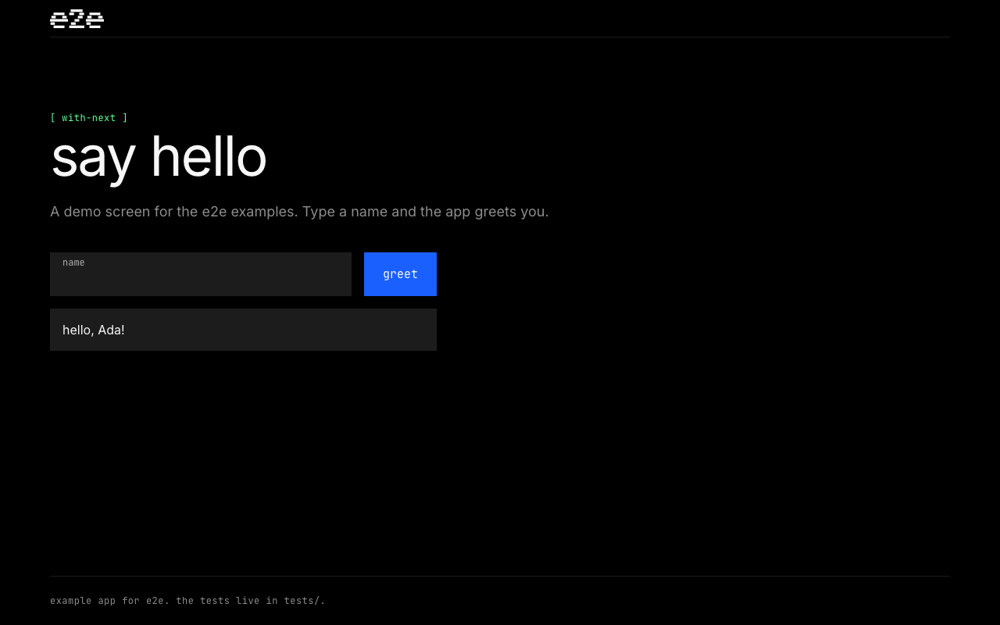

# e2e with GitHub Actions

A Next.js App Router greeting app whose e2e tests run on every pull request
and every push to `main`. It has three locator tests and two agent tests.



## The workflow

[.github/workflows/e2e.yml](.github/workflows/e2e.yml) was written by
`npx e2e init --ci github-actions`. On each run it:

1. Installs dependencies with `npm ci` on Node 24.
2. Restores Chromium from the cache, or installs it with
   `npx e2e-web install chromium --with-deps`.
3. Runs `npx e2e run --reporter list,junit`. The app starts on its own.
4. Uploads `.e2e/report.json`, `.e2e/junit.xml`, and `.e2e/results` as the
   `e2e-report` artifact, even when tests fail. The artifact is kept for 7 days.

A new push to a pull request cancels the run still in progress for it.

## Agent tests in CI

Add a [Vercel AI Gateway](https://vercel.com/docs/ai-gateway) key as a
repository secret named `AI_GATEWAY_API_KEY` (**Settings → Secrets and
variables → Actions**). Without it, the agent tests skip and the locator tests
still run.

Pull requests from forks don't get repository secrets, so their agent tests skip.

## Run locally

Use Node 22.22.3+, 24.8+, or 26+. From this folder:

```bash
npm install
AI_GATEWAY_API_KEY="your-key" npm run test:e2e
```

The runner starts the app at `http://localhost:3100` and downloads Chromium on
the first run if needed. Leave out the key to run only the locator tests. Add
`-- --no-cache` to use fresh model calls. Results are in `.e2e/report.json`.

See [e2e.config.ts](e2e.config.ts) and [tests/](tests/) for the setup.
For your own repository, follow the
[GitHub Actions guide](https://e2e.com/docs/ci/github-actions).

Last checked with e2e 0.23.0, @e2e-dev/web 0.15.5, Next.js 16.4, and Node 24.

<a href="https://e2e.com">
  <picture>
    <source media="(prefers-color-scheme: dark)" srcset="e2e-logo-white.png">
    
  </picture>
</a>
